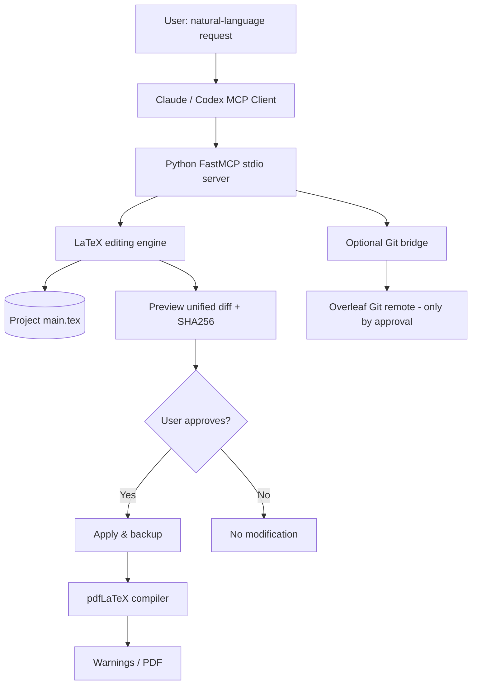

# Architecture and design decisions

## Decisions
- Safe, narrow scope edits minimize accidental rewrites.
- SHA-256 base hash rejects stale previews.
- Backups are local and gitignored.
- Git push requires explicit user approval and an already clean Git tree.
- No direct remote access unless Git Bridge is separately configured.
- STDIO logs must go to stderr; writing debug strings to stdout can corrupt MCP protocol frames.
